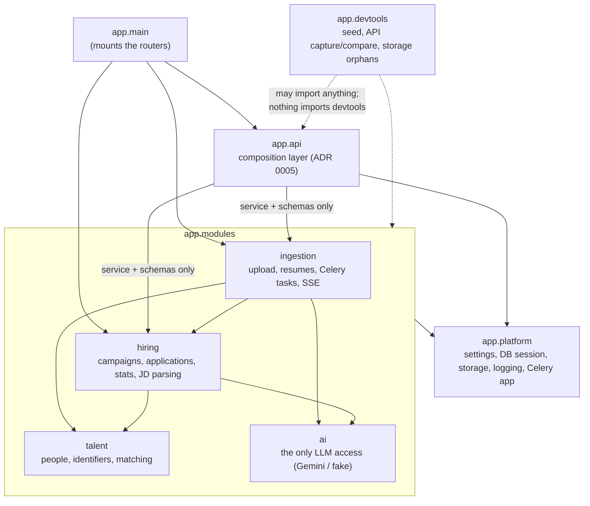

# AI Resume Bulk Import System

> Scalable, AI-powered bulk resume processing and candidate categorization platform built with FastAPI, Celery, Next.js, and Google Gemini.

---

## Architecture

One FastAPI backend and two Celery workers, organised as a **modular monolith**
([ADR 0001](docs/adr/0001-modular-monolith.md)): one deployable, one Postgres database, and the
code split into domain modules with boundaries enforced by import-linter in CI.

```
Next.js (frontend) ──HTTP / SSE──▶ FastAPI ──Celery (Redis)──▶ extract worker ──▶ AI worker ──▶ Gemini
                                     │                              │                │
                                     └──── PostgreSQL 16 (pgvector) · MinIO (PDFs) · Redis (queues, SSE pub/sub)
```

### Modules and allowed dependencies



An arrow means "may import". The 8 import-linter contracts in
[`backend/pyproject.toml`](backend/pyproject.toml) enforce it:

- Layers `ingestion → hiring → talent`; `talent` and `ai` import no other module.
- A module may import another module only through its **public interface**, `service.py` and
  `schemas.py`, never its `models`, `repository`, `router` or `tasks`. `app.api` follows the same
  rule.
- `platform` imports no module, nothing below `app.api` imports it, nothing imports `devtools`,
  and only `ai` may import an LLM SDK (`google.*`).
- Each module owns its tables, and no foreign key crosses a module boundary
  ([ADR 0003](docs/adr/0003-no-cross-module-foreign-keys.md), checked on the live schema by
  `backend/tests/test_no_cross_module_foreign_keys.py`). Cross-module references are plain UUIDs,
  kept consistent by the services and checked by `verify_people_applications`.

### Request flow

```
HTTP ─▶ router (module's router.py, or app/api/routes.py when an endpoint needs several modules)
     ─▶ service.py (business rules; the module's public interface)
     ─▶ repository.py (SQLAlchemy 2.0 queries on the module's own tables)
```

Routers stay thin. An endpoint that spans modules (campaign detail and stats, every candidate
endpoint, campaign and candidate deletes) lives in `app/api` and calls each module's service in
one request transaction ([ADR 0005](docs/adr/0005-composition-layer.md)). The `/api/v1/candidates*`
endpoints are a compatibility layer: they serve Applications in the pre-E0 response shapes,
pinned by 179 snapshot tests in
[`backend/tests/characterization`](backend/tests/characterization/README.md).

### Upload flow

```
POST /campaigns/{id}/upload            ingestion: validate, hash, store the PDF in MinIO, insert resumes rows
  └─▶ extract_queue: extract_resume    PDF → text (pdfplumber, PyMuPDF, else OCR through ai) → resumes.raw_text
        └─▶ ai_queue: process_candidate_ai
              1. ai.extract_profile    → resumes.extracted (snapshot; skipped on a retry)
              2. ai.score              against the campaign's role and skills
              3. talent.resolve_person ┐ one transaction: find or create the Person
              4. hiring.upsert_application ┘ (advisory locks) and write the Application
  each step ─▶ Redis channel campaign:{id}:events ─▶ GET /campaigns/{id}/stream (SSE)
```

Every step is safe to re-run, `resumes.processing_step` records where a failure stopped, and a
Gemini quota error shows as `quota_exceeded` at once (spec §5). Each campaign has its own event
channel, so a stream only ever receives its own campaign's events.

### Data model

| Module | Table | What it holds |
|---|---|---|
| talent | `people` | One row per human, across campaigns; profile from their newest resume |
| talent | `person_identifiers` | Normalised emails and phones, unique per `(kind, value)`; the matching key ([ADR 0004](docs/adr/0004-identity-matching-policy.md)) |
| talent | `identity_conflicts` | Email and phone pointing at different people: recorded, never auto-merged |
| talent | `person_resumes` | Which Person each resume resolved to (makes resolution idempotent) |
| hiring | `campaigns` | A job: role, required skills, status |
| hiring | `applications` | A Person applying to one campaign (`UNIQUE(campaign_id, person_id)`): scoring, category, pipeline stage, notes |
| hiring | `legacy_candidate_map` | Old candidate ids merged into an application, so old links still resolve |
| ingestion | `resumes` | An uploaded PDF: status, processing step, text, extraction snapshot, its Person |

The legacy `candidates` table was split into People and Applications
([ADR 0002](docs/adr/0002-person-application-split.md)) by an expand → backfill → switch →
contract migration, and dropped in E0-20.

### Further reading

- Design spec: [E0 · Platform core](docs/specs/EPIC-00-platform-core.md); roadmap:
  [docs/roadmap.md](docs/roadmap.md); working process: [docs/process.md](docs/process.md)
- ADRs: [0001 modular monolith](docs/adr/0001-modular-monolith.md) ·
  [0002 Person/Application split](docs/adr/0002-person-application-split.md) ·
  [0003 no cross-module foreign keys](docs/adr/0003-no-cross-module-foreign-keys.md) ·
  [0004 identity matching](docs/adr/0004-identity-matching-policy.md) ·
  [0005 composition layer](docs/adr/0005-composition-layer.md)
- Runbook: [backfill, read switch and contract](docs/runbooks/person-application-backfill.md)
- Sprints: [1](docs/sprints/sprint-01.md) · [2](docs/sprints/sprint-02.md) ·
  [3](docs/sprints/sprint-03.md) · [4](docs/sprints/sprint-04.md); open follow-ups:
  [docs/backlog.md](docs/backlog.md)

## Features

- **Bulk Upload**: Drag-and-drop up to 50 PDF resumes at once
- **AI Extraction**: Name, email, skills, experience, education via Gemini 2.5 Flash
- **Hybrid PDF Parsing**: pdfplumber (native) → PyMuPDF → Gemini Vision (scanned PDFs)
- **Real-time Updates**: Server-Sent Events (SSE) stream live processing status per file
- **AI Scoring**: Each candidate scored 0–100 against job role requirements
- **Smart Categorization**: Strong Match / Moderate Match / Weak Match / Rejected
- **Candidate Dashboard**: Filter by skill, score range, category, search by name
- **Analytics Panel**: Pie chart (category distribution) + Bar chart (top skills)
- **Celery Monitoring**: Flower dashboard at `localhost:5555`
- **Retry Logic**: 3 automatic retries per failed task; every step is safe to re-run, and a quota error retries after the provider's retry delay

---

## Quick Start

### 1. Prerequisites
- Docker + Docker Compose
- Google Gemini API key ([get one here](https://aistudio.google.com/app/apikey)), or set
  `AI_PROVIDER=fake` to run without Gemini

### 2. Configure environment
```bash
cp .env.example .env
# Edit .env and set your GEMINI_API_KEY (or AI_PROVIDER=fake to run without one)
```

If a default host port (5432, 6379, 9000, 9001, 8000, 3000, 5555) is already
used on your machine, change the matching `*_HOST_PORT` variable in `.env`.

### 3. Start the stack and run migrations
```bash
make setup
```

This builds the images, starts every service, waits until they report
healthy, runs `alembic upgrade head`, and then seeds fake data with `make seed`
(skipped if the database already has applications). Without `make`, run the same steps:

```bash
docker compose up --build -d --wait
docker compose exec backend alembic upgrade head
docker compose exec -T backend python -m app.devtools.seed --people 800 --campaigns 15 --seed 42 --if-empty
```

#### Seed data
`make seed` runs `python -m app.devtools.seed` inside the backend container. With the defaults
(`--people 800 --campaigns 15 --seed 42`) it creates 15 campaigns and about 1,100 processed
resumes generated with Faker, and runs each through the upload pipeline's matching and scoring
services (without the AI: the scoring is generated too), which creates the People and
Applications (about 800 people and 1,100 applications). No files are uploaded, so downloads of
seeded resumes do not work. The same `--seed` always produces the same data.

- It refuses to run when `APP_ENV=production`.
- It refuses if any application already exists. `make seed SEED_FLAGS=--reset` first deletes
  **every** campaign, resume, application and person (and prints how many); nothing else is
  touched.
- Change sizes with `make seed SEED_ARGS="--people 100 --campaigns 4 --seed 7"`.
- The data deliberately contains the identity edge cases of the person split (spec §6.4):
  emails differing only in case, Gmail dot and `+tag` variants, phone format variants, people
  applying to several campaigns or twice to one, an email/phone conflict between two people,
  and resumes without contact details.
- It writes `backend/seed-manifest.json` (gitignored) with the rows it created and the number
  of People, Applications and identity conflicts the matching rules must produce, derived
  without running the matching code (documented in `backend/app/devtools/seed.py`). Check them
  with `docker compose exec backend python -m app.modules.ingestion.verify_people_applications
  --manifest /app/seed-manifest.json`.

> Upgrading from an older checkout? The Postgres image moved from 15 to 16
> (`pgvector/pgvector:pg16`), so run `docker compose down -v` once to drop the
> old local volume. Local data is thrown away.

### 4. Open the app
| Service | URL |
|---|---|
| Frontend (Next.js) | http://localhost:3000 |
| Backend API Docs | http://localhost:8000/docs |
| Flower (Celery) | http://localhost:5555 |
| MinIO Console | http://localhost:9001 |

---

## Usage Flow

1. **Create Campaign** → set role + required skills (e.g. "AI Engineer", Python, FastAPI, LLMs)
2. **Upload Resumes** → drag & drop up to 50 PDFs
3. **Watch Live Processing** → SSE updates show each file: Extracting → AI Analysis → Done
4. **Review Candidates** → sorted by AI score, filterable by category/skill/experience
5. **View Detail** → full profile with strengths, weaknesses, missing skills, recommendation
6. **Override Category** → manually adjust AI classification if needed

---

## Development (without Docker)

### Backend
```bash
cd backend
uv sync                 # creates .venv from uv.lock (incl. dev tools); install uv: https://docs.astral.sh/uv/
source .venv/bin/activate
pre-commit install      # optional: run ruff + mypy + import-linter on every commit (make lint / format / typecheck / test)

# Start services locally (need redis + postgres + minio running).
# AI_PROVIDER=fake runs the whole pipeline without a Gemini key (deterministic answers).
uvicorn app.main:app --reload --port 8000

# Worker 1 (PDF extraction)
celery -A app.platform.celery_app worker -Q extract_queue --concurrency=4 --loglevel=info

# Worker 2 (AI processing)
celery -A app.platform.celery_app worker -Q ai_queue --concurrency=2 --loglevel=info
```

### Backend tests
```bash
make test               # or, from backend/: uv run pytest
```
Tests need only **Docker** running. The session starts a throwaway `pgvector/pgvector:pg16`
container with [testcontainers](https://testcontainers.com/), runs `alembic upgrade head` on it,
and wraps every test in a transaction that is rolled back. Celery dispatch, MinIO, Redis and
Gemini are replaced with in-memory fakes; no Redis, MinIO or Gemini access is needed (tests that
don't pin Gemini specifics use `AI_PROVIDER=fake` through the `fake_ai` fixture). Coverage is
printed after each run. Fixtures are documented at the top of `backend/tests/conftest.py`.

`backend/tests/characterization/` holds snapshot tests that record what every API endpoint
returns today; they define the API contract. Read its
[README](backend/tests/characterization/README.md) before running `--snapshot-update`.

### Frontend
```bash
cd frontend
npm install
NEXT_PUBLIC_API_URL=http://localhost:8000 npm run dev
```

---

## Project Structure

```
.
├── backend/
│   ├── app/
│   │   ├── platform/         # Shared kernel (no imports from modules/)
│   │   │   ├── config.py     # Pydantic settings
│   │   │   ├── database.py   # Async SQLAlchemy
│   │   │   ├── storage.py    # MinIO/S3 abstraction
│   │   │   ├── logging.py    # structlog setup
│   │   │   └── celery_app.py # Celery app + routing (`celery -A app.platform.celery_app`)
│   │   ├── modules/          # Domain modules (EPIC-00 §3); each exposes service.py + schemas.py
│   │   │   ├── hiring/       # Campaigns, applications, stats, JD parsing
│   │   │   │   ├── router.py     # Thin HTTP layer (campaign CRUD, parse-jd)
│   │   │   │   ├── service.py    # Public interface + business rules
│   │   │   │   ├── repository.py # Queries
│   │   │   │   ├── models.py     # Campaign, Application, LegacyCandidateMap ORM models
│   │   │   │   └── schemas.py    # Request/response schemas
│   │   │   ├── ingestion/    # Upload pipeline
│   │   │   │   ├── router.py     # Upload, resume list/detail, retry-failed, SSE stream
│   │   │   │   ├── service.py    # Public interface (upload, resume counts/deletes)
│   │   │   │   ├── repository.py # Queries on resumes
│   │   │   │   ├── models.py     # Resume ORM model
│   │   │   │   ├── schemas.py    # Request/response schemas
│   │   │   │   ├── tasks.py      # Celery: PDF → text → AI → Person + Application
│   │   │   │   ├── events.py     # Redis pub/sub progress events, one channel per campaign (SSE source)
│   │   │   │   ├── pdf.py        # pdfplumber + PyMuPDF
│   │   │   │   ├── reset_stuck.py # Ops: re-queue stuck resumes
│   │   │   │   └── verify_people_applications.py # Ops: cross-module consistency check
│   │   │   ├── ai/           # All LLM access, behind the AIService protocol
│   │   │   │   ├── service.py    # AIService, errors, get_ai_service() (AI_PROVIDER)
│   │   │   │   ├── schemas.py    # ExtractionResult, ScoringResult, JDParseResult
│   │   │   │   ├── gemini.py     # Google Gemini implementation
│   │   │   │   ├── fake.py       # Deterministic offline implementation (AI_PROVIDER=fake)
│   │   │   │   └── prompts.py    # Prompt templates
│   │   │   └── talent/       # People, identifiers, conflicts; resolve_person (service.py), normalisation (identity.py)
│   │   ├── api/              # Composition layer: endpoints spanning several modules
│   │   │   └── routes.py     # Campaign detail/stats, global stats, candidate endpoints, deletes
│   │   ├── devtools/         # Dev-only scripts; never imported by app code
│   │   └── main.py           # FastAPI app + lifespan
│   └── alembic/              # Database migrations
├── frontend/
│   └── src/
│       ├── app/              # Next.js App Router pages
│       │   ├── page.tsx              # Dashboard
│       │   ├── campaigns/page.tsx    # Campaign list
│       │   ├── campaigns/new/page.tsx
│       │   ├── campaigns/[id]/page.tsx  # Upload + Candidates + Stats
│       │   └── candidates/[id]/page.tsx # Full candidate profile
│       ├── components/
│       │   ├── Sidebar.tsx
│       │   ├── UploadZone.tsx    # Drag-and-drop + SSE consumer
│       │   ├── CandidateTable.tsx
│       │   └── StatsPanel.tsx   # Recharts analytics
│       └── lib/api.ts           # Typed API client
├── docker-compose.yml
├── .env.example
└── README.md
```

---

## API Reference

| Method | Endpoint | Description |
|---|---|---|
| POST | `/api/v1/campaigns` | Create campaign |
| GET | `/api/v1/campaigns` | List all campaigns |
| GET | `/api/v1/campaigns/{id}` | Get campaign + stats |
| POST | `/api/v1/campaigns/{id}/upload` | Bulk upload PDFs |
| GET | `/api/v1/campaigns/{id}/stream` | SSE real-time updates (this campaign's resumes only) |
| GET | `/api/v1/campaigns/{id}/candidates` | List candidates (with filters) |
| GET | `/api/v1/candidates/{id}` | Full candidate profile |
| PUT | `/api/v1/candidates/{id}/category` | Override category |
| GET | `/health`, `/health/ready` | Liveness and readiness (`/api/v1/health` is not mounted: B10) |

---

## Environment Variables

| Variable | Description | Default |
|---|---|---|
| `AI_PROVIDER` | `gemini` (Google Gemini) or `fake` (deterministic offline answers, no API key needed; for local dev and smoke tests) | `gemini` |
| `GEMINI_API_KEY` | Google Gemini API key. **Required** when `AI_PROVIDER=gemini` (start-up fails with a clear error without it); not needed with `AI_PROVIDER=fake` | — |
| `GEMINI_MODEL` | Gemini model to use | `gemini-2.5-flash` |
| `DATABASE_URL` | Async PostgreSQL URL | — |
| `REDIS_URL` | Redis connection URL | `redis://redis:6379/0` |
| `MINIO_ENDPOINT` | MinIO host | `minio:9000` |
| `MAX_FILE_SIZE_MB` | Max PDF size | `10` |
| `MAX_FILES_PER_BATCH` | Max files per upload | `50` |
| `*_HOST_PORT` | Host ports for Postgres, Redis, MinIO API/console, backend, frontend, Flower | `5432`, `6379`, `9000`, `9001`, `8000`, `3000`, `5555` |

---

## Future Improvements (from problem statement)

- [ ] JWT authentication (FastAPI-Users)
- [ ] Semantic search with embeddings (pgvector)
- [ ] Candidate-chat assistant (RAG)
- [ ] Resume duplicate detection
- [ ] Email notifications (SendGrid)
- [ ] Interview scheduling
- [ ] ATS integration
- [ ] Cloud Run / GKE deployment configs
